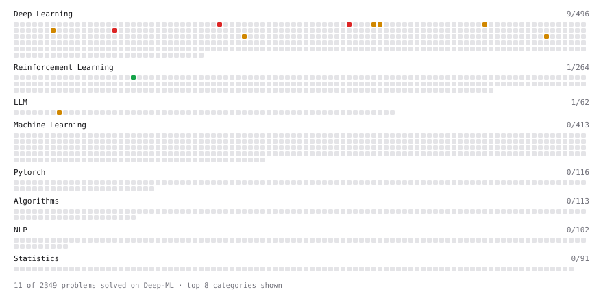

# Deep-ML

My machine learning practice from [Deep-ML](https://www.deep-ml.com). Every solution here was written by hand.

**10** solved · 10 problems · 0 labs · 0 math

[**Browse the interactive portfolio**](https://haotiansun14.github.io/deep-ml/) to replay this filling in over time.

## Problems

| | Difficulty | Solved | |
| --- | --- | --- | --- |
| [KL Divergence Estimator for GRPO](https://www.deep-ml.com/problems/225) | easy | 2026-11-09 | [solution](problems/0225-kl-divergence-estimator-for-grpo) |
| [Implement Gated Attention](https://www.deep-ml.com/problems/271) | medium | 2026-11-19 | [solution](problems/0271-implement-gated-attention) |
| [KV Cache for Efficient Autoregressive Attention](https://www.deep-ml.com/problems/376) | medium | 2026-11-19 | [solution](problems/0376-kv-cache-for-efficient-autoregressive-attention) |
| [LoRA: Low-Rank Adaptation Forward Pass](https://www.deep-ml.com/problems/222) | medium | 2026-11-15 | [solution](problems/0222-lora-low-rank-adaptation-forward-pass) |
| [MLP Character-Level Language Model Forward Pass](https://www.deep-ml.com/problems/989) | medium | 2026-11-19 | [solution](problems/0989-mlp-character-level-language-model-forward-pass) |
| [QLoRA: Quantized Low-Rank Adaptation Forward Pass](https://www.deep-ml.com/problems/223) | medium | 2026-11-15 | [solution](problems/0223-qlora-quantized-low-rank-adaptation-forward-pass) |
| [Top-p (Nucleus) Sampling](https://www.deep-ml.com/problems/383) | medium | 2026-11-13 | [solution](problems/0383-top-p-nucleus-sampling) |
| [Flash Attention v1 - Forward Pass](https://www.deep-ml.com/problems/208) | hard | 2026-11-19 | [solution](problems/0208-flash-attention-v1-forward-pass) |
| [Implement a Sparse Mixture of Experts Layer](https://www.deep-ml.com/problems/125) | hard | 2026-11-13 | [solution](problems/0125-implement-a-sparse-mixture-of-experts-layer) |
| [Implement Speculative Decoding Verification](https://www.deep-ml.com/problems/394) | hard | 2026-11-08 | [solution](problems/0394-implement-speculative-decoding-verification) |

---

_This file is regenerated by Deep-ML on every push._
